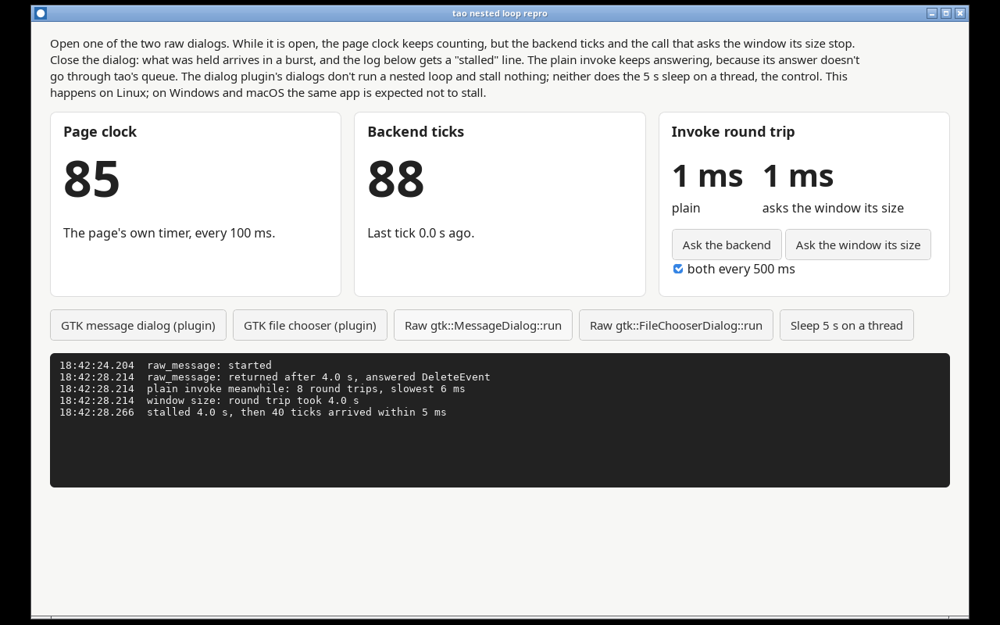

# tao nested loop repro

A small Tauri 2 app showing that on Linux, while a nested GLib main loop runs on the main thread (here a GTK dialog's `gtk_dialog_run`), events sent to tao from other threads wait until it ends and then arrive in a burst.

Tested with tauri 2.12.3, tao 0.37.1, wry 0.57.1, tauri-plugin-dialog 2.8.4 and gtk 0.18.2 (pinned in `src-tauri/Cargo.lock`), on Debian 13 with WebKitGTK 2.54, X11.



## Run it

With Tauri's Linux prerequisites installed:

```sh
npm install && npm tauri dev
```

## What you should see

The page shows a clock the page counts itself, the ticks the backend emits every 100 ms, and two invoke round trips, each sent every 500 ms when the box is ticked.

1. Press **Raw gtk::MessageDialog::run** or **Raw gtk::FileChooserDialog::run**.
2. While the dialog is open, the page clock keeps counting. The backend ticks stop, and so does the invoke that asks the window its size.
3. Close the dialog. The held ticks arrive at once, and the log says so, for example `stalled 4.0 s, then 40 ticks arrived within 5 ms`.

The plain invoke keeps answering throughout. **Sleep 5 s on a thread** is the control: it blocks a thread for 5 s and stalls nothing. The two dialog plugin buttons stall nothing either: tauri-plugin-dialog 2.8 shows its GTK dialogs without a nested loop, even through `blocking_show` and `blocking_pick_file`.

On Windows and macOS the same app is expected not to stall.

To run it unattended, set `REPRO_AUTO` to a trigger's command name (`raw_message`, `raw_file`, `plugin_message`, `plugin_file` or `sleep_on_thread`), `REPRO_AUTO_CLOSE_MS=4000` to close the dialog after 4 s, and `REPRO_LOG_FILE` to a path: the app presses the trigger, writes the page's log there and quits.

## Why it happens

Every event sent through tao's `EventLoopProxy` goes into a channel that only `run_return` reads, between its own calls to `gtk::main_iteration_do`. `send_event` also wakes the GLib main context, but nothing in a nested loop reads the channel. So while `gtk_dialog_run` or a drag's held data request runs a nested loop, everything other threads send waits: Tauri's `emit`, `eval`, `run_on_main_thread` and window calls such as `inner_size`. GTK, WebKit and anything driven by GLib sources keep running, which is why the page and the plain invoke, whose answer wry hands to `MainContext::invoke`, carry on.

Related: tao [#625](https://github.com/tauri-apps/tao/issues/625) and [#626](https://github.com/tauri-apps/tao/pull/626) (the wakeup in `send_event`), [#635](https://github.com/tauri-apps/tao/issues/635) (the Linux event loop design), and plugins-workspace [#956](https://github.com/tauri-apps/plugins-workspace/issues/956) and [#3224](https://github.com/tauri-apps/plugins-workspace/issues/3224) (blocking dialogs on Linux).

## The fix

Dispatch tao's queue from a GLib source too, so that any main loop iteration, nested or not, delivers it.

## Files

- `ui/`: the page.
- `src-tauri/`: the Rust side.

## Licence

MIT, see [LICENSE](LICENSE).
